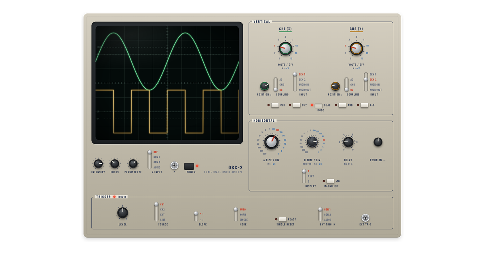

# OSC-2 / FG-2 — Dual-Trace Oscilloscope Simulator



A browser simulation of a classic **analog dual-trace oscilloscope** with rotary knobs, toggle switches
and a dual time base, together with a two-channel **function generator**. The scope inputs can also be
switched to the computer's or phone's **sound card**, so it works as a real sound-card oscilloscope.

Article and live demo: [Dual Trace Sound Card Oscilloscope — motleyscience.com](https://motleyscience.com/dual-trace-sound-card-oscilloscope/)

## Features

**OSC-2 oscilloscope**
- Two channels: VOLTS/DIV 10 mV–5 V (1-2-5), position, AC / GND / DC coupling.
- Input per channel: GEN 1, GEN 2, AUDIO IN (microphone / line-in, stereo L → CH1, R → CH2) or
  AUDIO OUT (the sound the computer is playing, via tab or screen sharing with audio).
- Vertical modes: CH1, CH2, DUAL, ADD, X-Y (Lissajous figures).
- Dual time base: A TIME/DIV 1 µs–0.5 s, delayed B sweep with DELAY, display A / A INT / B, ×10 magnifier.
  Slow sweeps travel across the screen in real time.
- Trigger: LEVEL, SOURCE CH1 / CH2 / EXT / LINE (internal 50 Hz), SLOPE, AUTO / NORM / SINGLE with RESET and READY.
- Z input (intensity modulation) and EXT TRIG input, each from a generator output or the audio input.
- Intensity, focus and phosphor persistence; readings of Vpp, Vrms, mean value and frequency.

**FG-2 function generator**
- Two outputs: sine, square, triangle, sawtooth, pulse (20 %) and noise, 0.5 Hz–100 kHz,
  amplitude, DC offset and phase.
- Each output can also be sent to the loudspeaker or headphones (OUT 1 left, OUT 2 right) with a volume control.

**Documentation** — `help.html` (operating manual) and `tips.html` (16 measurement procedures with worked
examples), each in English, German, Russian and Hungarian with a language switch.

## Files

| File | Contents |
| --- | --- |
| `index.html` | The instruments (single self-contained page) |
| `help.html` | Operating manual (EN / DE / RU / HU) |
| `tips.html` | Measurement tips (EN / DE / RU / HU) |
| `manual.css`, `manual.js` | Style and language switch of the two documentation pages |
| `favicon.svg`, `vercel.json` | Icon and Vercel settings |
| `LICENSE.txt` | GNU General Public License v3 |

## Running it

It is a static site with no build step. Live audio needs a secure context: `https://`, or `http://localhost`
on your own computer.

```sh
python3 -m http.server 8000
# then open http://localhost:8000
```

## Deploying to Vercel

On vercel.com choose **Add New → Project**, import this repository, set the Framework Preset to **Other**
and leave Build Command and Output Directory empty. Every push to the repository is then deployed automatically.

## Embedding in WordPress
Add a *Custom HTML* block (or an Elementor *HTML* widget) with the following.
Replace `YOUR-SITE.vercel.app` with the address of the simulator — only in the `src`.

```html
<iframe id="osc2" src="https://YOUR-SITE.vercel.app/?embed" title="Dual-Trace Oscilloscope"
        style="width:100%;height:4000px;border:0;display:block"
        allow="microphone; display-capture"></iframe>
<script data-no-optimize="1" data-no-defer="1" data-cfasync="false" nowprocket>
(function () {
  var f = document.getElementById("osc2");
  function ask() { if (f.contentWindow) f.contentWindow.postMessage({ type: "osc2-ping" }, "*"); }
  window.addEventListener("message", function (e) {
    if (e.source !== f.contentWindow || !e.data || e.data.type !== "osc2-height") return;
    f.style.setProperty("height", e.data.height + "px", "important");
  });
  f.addEventListener("load", ask);
  ask();
})();
</script>
```

- `?embed` makes the background transparent, so the page's own background shows through, and uses dark lettering.
- On a dark page use `?embed&theme=dark`; or give an exact colour, e.g. `?embed&bg=f7f8f9` (lettering is chosen automatically).
- The script sets the iframe to the simulator's exact height, so there is no inner scroll bar. It accepts
  messages only from its own iframe, works even when an optimiser delays it, and contains no `&` that
  WordPress could re-encode. The `data-no-optimize` / `nowprocket` attributes ask caching plugins to leave it alone.
- `allow="microphone; display-capture"` lets the AUDIO IN / AUDIO OUT inputs work inside the embedded page.
- In embedded mode the Manual and Measurement tips open in a new tab.

## Licence

Copyright © 2026 András Sümegi

This program is free software: you can redistribute it and/or modify it under the terms of the
GNU General Public License as published by the Free Software Foundation, either version 3 of the
License, or (at your option) any later version.

This program is distributed in the hope that it will be useful, but **WITHOUT ANY WARRANTY**; without
even the implied warranty of MERCHANTABILITY or FITNESS FOR A PARTICULAR PURPOSE. See
[`LICENSE.txt`](LICENSE.txt) for the full text.
